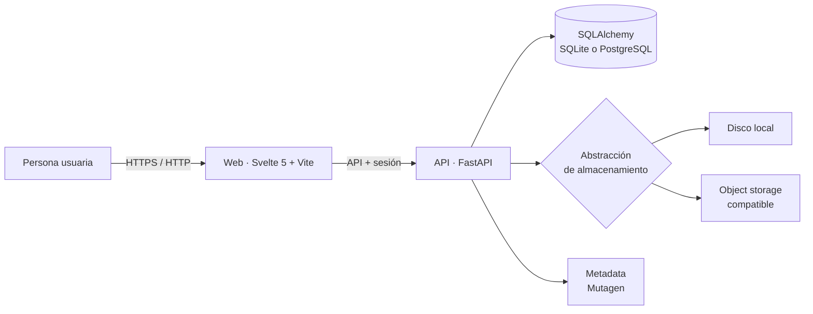
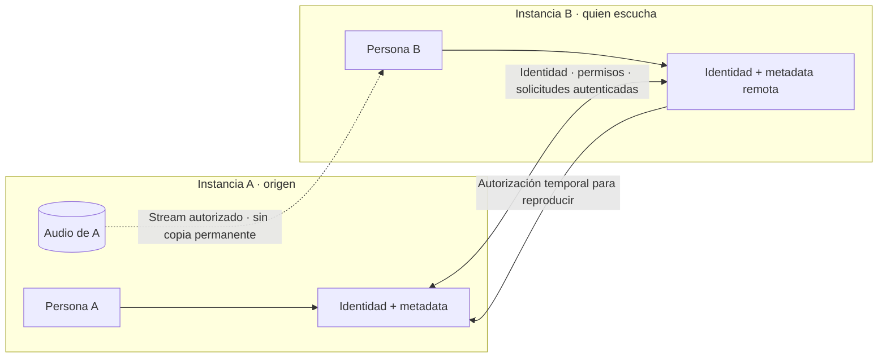
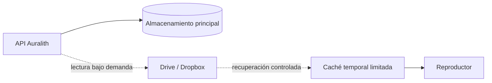
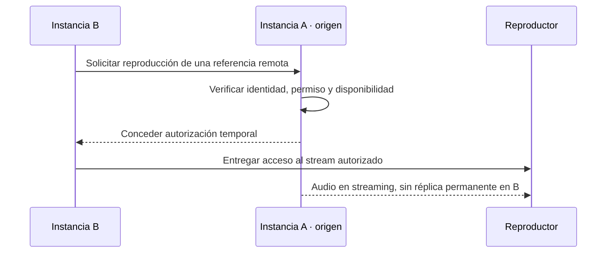
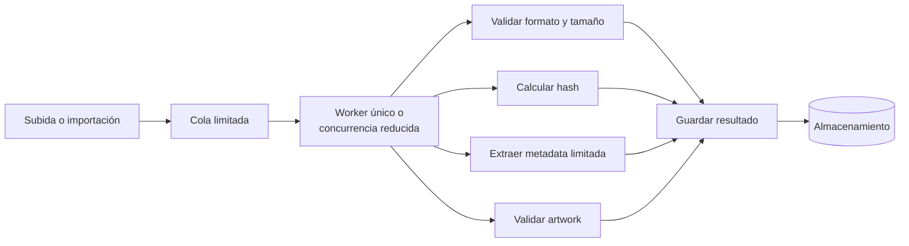

<div align="center">
  
  <br>
  
  <h3>Tu música. Tu servidor. Tus reglas.</h3>
  <p>Tu biblioteca musical, alojada por ti y diseñada para crecer sin perder el control.</p>
  <p><strong>Idioma / Language:</strong> <a href="#english">🇬🇧 English</a> · <a href="#espanol">🇪🇸 Español</a></p>
  <p>
    <a href="#quick-start">Empezar</a> ·
    <a href="#arquitectura-de-un-vistazo">Arquitectura</a> ·
    <a href="#seguridad-ligera-por-diseño">Seguridad</a> ·
    <a href="#26-roadmap">Roadmap</a>
  </p>
  <sub>SELF-HOSTED · OPEN SOURCE · PRIVACY FIRST · MODULAR</sub>
</div>

<br>

> **Ahora:** MVP personal, ligero y autoalojado. **Visión:** una red musical federada, sin servidor central obligatorio.
> La federación y el procesamiento avanzado que se describen abajo son objetivos de diseño, no funciones disponibles en el MVP actual.

<a id="english"></a>

## English

AURALITH is a self-hosted, open-source platform for storing and playing a personal music library. The current MVP focuses on one owner: secure login, private MP3/FLAC uploads, metadata extraction, playlists, favorites, HTTP Range playback, SQLite backups/restores, and Docker deployment.

### Quick start

Requirements: Docker Compose.

```bash
AURALITH_OWNER_PASSWORD="choose-a-secure-password" docker compose up --build
```

Open `http://localhost:8080`. The owner username defaults to `owner` and can be changed with `AURALITH_OWNER_USERNAME`.

The stack stores data in the `auralith-data` Docker volume. Backups and restores are available from `/api/backup` and `/api/restore` for the SQLite deployment.

### Providers

The backend is not coupled to Supabase or to a local installation:

- Set `AURALITH_DB_URL` to any SQLAlchemy-compatible PostgreSQL or SQLite URL.
- Set `AURALITH_STORAGE_PROVIDER=local` for filesystem storage.
- Set `AURALITH_STORAGE_PROVIDER=supabase` and provide `SUPABASE_URL`, `SUPABASE_SECRET_KEY`, and `SUPABASE_STORAGE_BUCKET` for Supabase Storage. `SUPABASE_SERVICE_ROLE_KEY` remains accepted only as deprecated compatibility.
- Set `AURALITH_STORAGE_PROVIDER=gdrive` with `AURALITH_GDRIVE_CLIENT_ID`, `AURALITH_GDRIVE_CLIENT_SECRET`, `AURALITH_GDRIVE_REFRESH_TOKEN`, and `AURALITH_GDRIVE_FOLDER_ID` to keep audio and artwork in a folder of your own Google Drive. Playback streams with HTTP Range, so seeking works without copying files to the server. The ZIP backup only covers SQLite plus local storage.
- Set `AURALITH_STORAGE_PROVIDERS` to a JSON list such as `[{"type":"gdrive"},{"type":"neon"}]` to run several backends at once: writes are mirrored to every provider, reads fall back to the next one when a backend is down or missing the object, and `AURALITH_STORAGE_MIRROR=false` writes only to the first backend that accepts. This replicates the media, not the database.
- Supabase PostgreSQL uses a regular PostgreSQL `AURALITH_DB_URL`; an optional adapter can later enable Supabase-specific features without changing the API modules.

### MVP scope

- Owner-managed multi-user accounts, invitations, and account activation
- Password authentication with Argon2 and HTTP-only sessions
- MP3 and FLAC uploads
- Mutagen metadata extraction
- Album artwork normalized to WebP thumbnails up to 512 px
- Private, per-user library isolation
- Range-based audio streaming
- Playlists and favorites
- ZIP backup and SQLite restore
- Docker Compose deployment

This is the complete V1 feature set. V1.5 (local friends) and V2 (federation) are not implemented.

### Neon database and storage

Neon can provide both PostgreSQL and S3-compatible object storage:

- Neon PostgreSQL: set `AURALITH_DB_URL` to the Neon PostgreSQL connection string.
- Neon Object Storage: set `AURALITH_STORAGE_PROVIDER=neon`.
- Set `NEON_URL` to the S3-compatible endpoint or `NEON_STORAGE_ENDPOINT`.
- Set `NEON_STORAGE_BUCKET=music`.
- Set `NEON_ACCESS_KEY_ID` and `NEON_SECRET_ACCESS_KEY`.

The Neon Storage connection panel may show standard AWS names instead:

- `AWS_ENDPOINT_URL_S3`
- `AWS_ACCESS_KEY_ID`
- `AWS_SECRET_ACCESS_KEY`
- `AWS_REGION`
- `AWS_BUCKET_NAME`
- `AWS_SESSION_TOKEN` if the object-storage provider issues temporary credentials

Use `AURALITH_STORAGE_PROVIDER=neon`; configure either the `NEON_*` names or these AWS-compatible names in Render. Do not expose the credentials in Vercel or in `VITE_*` variables.

Alternatively, use `AURALITH_STORAGE_PROVIDER=supabase` with Supabase Storage variables.

### Deployment

#### Supabase + Render

1. Create a PostgreSQL database in Supabase and configure `AURALITH_DB_URL` with the PostgreSQL connection string.
   - On Render, prefer the Supabase IPv4-compatible **Transaction pooler** string.
   - Use port `6543`; avoid the direct connection on port `5432` if Render reports IPv6 network errors.
   - The SQLAlchemy URL should use `postgresql+psycopg://` and include `sslmode=require` when supported.
2. Apply `supabase/migrations/202611230001_initial.sql`.
3. Create a private Supabase Storage bucket named `music`.
4. Deploy `apps/api` to Render using `render.yaml` or the Dockerfile.
5. Set `SUPABASE_URL`, `SUPABASE_SECRET_KEY`, `SUPABASE_STORAGE_BUCKET`, `AURALITH_OWNER_PASSWORD`, `AURALITH_CORS_ORIGINS=https://<your-vercel-app>.vercel.app`, and `AURALITH_COOKIE_SAMESITE=none`.
6. Deploy `apps/web` on Vercel and set `VITE_API_URL=https://<your-render-service>.onrender.com`.
7. Never expose `SUPABASE_SECRET_KEY` to the frontend.

For Render, use a **Web Service** with:

- **Root Directory:** leave it blank.
- **Language/Environment:** Docker.
- **Dockerfile Path:** `apps/api/Dockerfile`.
- **Docker Build Context Directory:** `.`
- **Health Check Path:** `/api/health`.

Do not select `apps/api` as the root directory. The Docker build needs the repository root to copy `pyproject.toml` and the `apps` package.

#### Local Docker

```bash
cp .env.example .env
AURALITH_OWNER_PASSWORD="change-this-password" docker compose up --build
```

Open `http://localhost:8080`. The SQLite database and music files are stored in the `auralith-data` Docker volume.

## Arquitectura de un vistazo

### MVP actual · modular y ligero

La aplicación mantiene una API monolítica modular y permite elegir proveedores de base de datos y almacenamiento. El diagrama muestra los componentes y opciones del MVP; no implica que todos los proveedores estén activos a la vez.



### Visión V2 · federación sin replicar audio

Cada instancia conserva su biblioteca y sus archivos. La federación intercambia identidad, metadatos y permisos; el audio se solicita al servidor de origen solo durante la reproducción autorizada.



> **La federación es una dirección futura.** Autenticación entre instancias, permisos remotos y streaming federado deben diseñarse e implementarse antes de habilitar este flujo.

### Evolución de almacenamiento · nube secundaria

Google Drive y Dropbox se contemplan como **almacenamiento frío opcional**, no como requisito ni como proveedor activo del MVP. La biblioteca y sus metadatos seguirían disponibles en la base principal; el audio archivado podría recuperarse bajo demanda y usar una caché local limitada, aceptando una primera reproducción más lenta.



La integración requerirá autorización OAuth del propietario, límites de cuota, manejo seguro de tokens y pruebas de streaming/rangos. No se almacenarán credenciales en el frontend ni se sincronizarán copias automáticamente.

---

<a id="espanol"></a>

## Español

## 1. Visión del proyecto

AURALITH es una plataforma de streaming musical personal, self-hosted y open source, que permite almacenar, organizar, importar y reproducir música desde una biblioteca propia.

La plataforma busca ofrecer una experiencia similar a los servicios comerciales de streaming, pero sin depender de suscripciones, algoritmos propietarios ni plataformas centralizadas.

Cada instalación pertenece a una persona que administra su instancia y puede invitar a familiares o amigos de confianza. En el MVP actual, las canciones forman un catálogo compartido dentro de la instancia; los perfiles, playlists, favoritos y canciones ocultas son por cuenta.

El objetivo inicial es ofrecer a un grupo pequeño cuentas independientes, reproducción fluida y una experiencia moderna tanto en ordenador como en móvil. La privacidad de bibliotecas separadas sigue siendo una posible evolución, no el comportamiento actual del catálogo.

La plataforma debe ser modular, segura, extensible y preparada para evolucionar hacia funcionalidades sociales descentralizadas en futuras versiones.

### Principios fundamentales

- **Self-hosted:** cada usuario puede alojar su propia instancia.
- **Privacy-first:** la privacidad es la configuración predeterminada.
- **Multi-user:** una instancia puede tener varios usuarios.
- **Open source:** código abierto y posibilidad de modificarlo.
- **Modular:** componentes independientes con interfaces claras.
- **Provider-agnostic:** integraciones sustituibles.
- **Security by design:** seguridad desde la arquitectura inicial.
- **Mobile-first:** experiencia optimizada para móvil.
- **Efficient:** infraestructura ligera y uso eficiente de recursos.
- **Extensible:** preparada para incorporar nuevas funcionalidades.
- **No central dependency:** el funcionamiento principal no depende de un servidor central del proyecto.

---

# 2. Alcance del proyecto

El proyecto se dividirá en versiones para evitar construir funcionalidades complejas antes de tener una aplicación funcional.

## V1 — Personal Music Cloud

La primera versión estará enfocada en crear una plataforma musical completamente funcional para uso personal y para compartir una instancia con familiares y amigos.

La prioridad será que la aplicación funcione perfectamente antes de añadir funcionalidades sociales avanzadas.

### Objetivo de V1

Una persona instala y administra su instancia.

Puede crear cuentas para sus padres, amigos u otros usuarios de confianza.

Cada usuario invitado puede:

- Acceder a su propio perfil.
- Configurar su contraseña.
- Consultar y reproducir el catálogo compartido de la instancia.
- Subir música al catálogo de la instancia.
- Ocultar canciones de su propia vista.
- Crear playlists.
- Marcar favoritos.
- Importar playlists externas.
- Reproducir música.
- Utilizar la aplicación desde ordenador y móvil.
- Mantener su propia configuración y dashboard.

El propietario administra las invitaciones y cuentas, y puede eliminar canciones del catálogo compartido. Las playlists, favoritos y preferencias de canciones ocultas pertenecen a cada cuenta.

### Funcionalidades principales de V1

- Sistema de usuarios y autenticación.
- Gestión de instancias.
- Multiusuario.
- Creación y activación de cuentas.
- Sesiones persistentes y seguras.
- Dashboard personal.
- Catálogo musical compartido por instancia con preferencias por usuario.
- Subida de música.
- Extracción de metadatos.
- Gestión de artistas, álbumes, canciones y géneros.
- Portadas.
- Detección de duplicados.
- Búsqueda.
- Reproductor global.
- Cola de reproducción.
- Shuffle y repeat.
- Playlists.
- Favoritos.
- Importación de playlists mediante CSV.
- Integración con proveedores externos cuando sea posible.
- Matching de canciones importadas.
- PWA.
- Compatibilidad móvil.
- Compartición controlada de playlists.
- Configuración de instancia.
- Gestión de usuarios.
- Backup y restauración.
- Documentación de instalación y self-hosting.

---

## V2 — Social y descentralización

La segunda versión ampliará la plataforma hacia una experiencia social sin necesidad de una infraestructura centralizada.

El objetivo será permitir que usuarios de diferentes instancias de Personal Music Cloud puedan encontrarse, añadirse como amigos e interactuar.

Cada instalación seguirá siendo independiente.

### Funcionalidades previstas

- Sistema de amigos entre diferentes instancias.
- Identidad federada.
- Solicitudes de amistad remotas.
- Aceptación y rechazo de solicitudes.
- Eliminación de amigos.
- Bloqueo de usuarios.
- Perfiles públicos configurables.
- Compartición de playlists entre instancias.
- Compartición de canciones y álbumes.
- Gestión de permisos remotos.
- Descubrimiento de otras instancias.
- Comunicación segura entre servidores.
- API de federación.
- Firma y validación de solicitudes.
- Protección contra spam y abuso.
- Rate limiting.
- Control de privacidad para perfiles remotos.

### Identidad federada

Cada usuario podrá identificarse mediante una identidad única asociada a su instancia.

Ejemplo:

```text
@andres@music.example.com
@juan@music-server.net
@alice@personal-audio.org
```

Los usuarios podrán añadir amigos independientemente de dónde esté alojada su instancia.

La federación no requerirá una base de datos central que almacene todos los usuarios.

### Principio de federación

```text
Instancia A                       Instancia B
┌──────────────────┐             ┌──────────────────┐
│ Personal Music   │             │ Personal Music   │
│ Cloud            │             │ Cloud            │
│                  │             │                  │
│ Andrés           │◄───────────►│ Juan             │
│                  │             │                  │
│ Biblioteca       │             │ Biblioteca       │
│ privada          │             │ privada          │
└──────────────────┘             └──────────────────┘
```

La relación social no implica automáticamente acceso a las bibliotecas.

Cada usuario decide qué compartir.

---

# 3. Modelo de instancias

Cada instalación de Personal Music Cloud constituye una instancia independiente.

Una instancia puede estar alojada en:

- Un servidor personal.
- Un VPS.
- Un ordenador doméstico.
- Un NAS.
- Un servidor Docker en el futuro.

La instancia tendrá un propietario responsable de su administración.

## Modos de funcionamiento

### Personal

Una única persona utiliza la instancia.

### Private Multi-user

El propietario invita a otros usuarios.

El acceso estará limitado a las personas autorizadas.

El modo multiusuario será el principal objetivo de V1, ya que permitirá compartir la infraestructura con familiares y amigos.

---

# 4. Roles y permisos

## OWNER

Propietario de la instancia.

Puede:

- Gestionar la instancia.
- Crear usuarios.
- Invitar usuarios.
- Suspender usuarios.
- Eliminar usuarios.
- Gestionar roles.
- Configurar cuotas.
- Gestionar almacenamiento.
- Configurar integraciones globales.
- Configurar seguridad.
- Gestionar permisos de compartición.
- Gestionar backups.
- Configurar la instancia.

El OWNER no tendrá acceso automático a:

- Bibliotecas privadas.
- Playlists privadas.
- Favoritos privados.
- Historial privado.
- Estadísticas personales.
- Tokens de proveedores de otros usuarios.

## ADMIN

Administrador delegado.

Puede realizar las tareas administrativas que le conceda el propietario.

No tendrá acceso automático a los datos privados de otros usuarios.

## MEMBER

Usuario normal.

Puede:

- Gestionar su biblioteca.
- Subir música.
- Crear playlists.
- Gestionar favoritos.
- Importar playlists.
- Gestionar integraciones personales.
- Configurar su perfil.
- Configurar su dashboard.
- Compartir recursos explícitamente.

---

# 5. Sistema de cuentas

## Creación de usuarios

El administrador podrá crear usuarios desde el frontend.

Por ejemplo:

```text
Administración
    └── Usuarios
          └── Crear usuario
```

Datos iniciales:

- Username.
- Display name.
- Email opcional.
- Rol.
- Estado.
- Cuota de almacenamiento.

El usuario no tendrá que registrarse públicamente.

La creación de cuentas estará controlada por el administrador.

## Activación de cuenta

Las cuentas creadas por el administrador tendrán inicialmente el estado:

```text
PENDING_ACTIVATION
```

Cuando el usuario acceda por primera vez a su perfil:

1. Seleccionará su usuario.
2. La aplicación comprobará que la cuenta está pendiente de activación.
3. Se mostrará un formulario para establecer su contraseña.
4. El usuario establecerá su propia contraseña.
5. El backend almacenará únicamente el hash seguro de la contraseña.
6. La cuenta pasará a estado `ACTIVE`.
7. Se creará una sesión autenticada.

El administrador nunca conocerá ni podrá consultar la contraseña del usuario.

### Estados de cuenta

```text
PENDING_ACTIVATION
ACTIVE
SUSPENDED
DISABLED
DELETED
```

---

# 6. Autenticación y sesiones

## Selector de perfiles

La aplicación contará con una pantalla inicial para seleccionar el usuario.

```text
┌────────────────────────────────────────┐
│         PERSONAL MUSIC CLOUD          │
│                                      │
│          ¿Quién está escuchando?      │
│                                      │
│       [ Andrés ]    [ Mamá ]         │
│                                      │
│       [ Papá ]      [ Invitado ]     │
│                                      │
└────────────────────────────────────────┘
```

El selector de perfiles será una comodidad de UX, no un mecanismo de autenticación.

## Primer acceso

Cuando un usuario acceda por primera vez:

- Seleccionará su perfil.
- Establecerá su contraseña si su cuenta está pendiente.
- Iniciará sesión.
- La aplicación podrá recordar su sesión en ese dispositivo.

## Accesos posteriores

Cuando un usuario seleccione su perfil:

- Si existe una sesión válida, accederá directamente.
- Si la sesión ha expirado, deberá autenticarse.
- Si la sesión ha sido revocada, deberá iniciar sesión nuevamente.

## Sesiones

Las sesiones serán independientes por dispositivo.

Se podrá:

- Recordar el usuario.
- Mantener una sesión persistente.
- Cerrar sesión.
- Revocar sesiones.
- Cerrar todas las sesiones.
- Consultar dispositivos conectados.

La autenticación deberá utilizar mecanismos seguros de sesión, rotación de refresh tokens y revocación.

---

# 7. Dashboard personal

Cada usuario tendrá su propio dashboard.

El dashboard no será una vista compartida entre usuarios.

## Widgets posibles

- Welcome.
- Continue listening.
- Recently played.
- Favorites.
- Recent albums.
- Recent artists.
- Playlists.
- Recently added.
- Shared with me.
- Listening statistics.
- Friends.
- Recomendaciones futuras.

El dashboard será personalizable.

El usuario podrá decidir qué widgets mostrar y cómo organizarlos.

---

# 8. Biblioteca musical

Cada usuario tendrá una biblioteca independiente.

La biblioteca estará organizada mediante entidades lógicas, independientemente de cómo se almacenen físicamente los archivos.

## Entidades principales

### Artists

- ID.
- Nombre.
- Imagen.
- Metadata.
- Relaciones con álbumes y canciones.

### Albums

- ID.
- Nombre.
- Artista.
- Año.
- Portada.
- Metadata.

### Tracks

- ID.
- Título.
- Artista.
- Álbum.
- Duración.
- Géneros.
- Metadata.
- Identificadores externos.

### Track Files

- ID.
- Track ID.
- Storage provider.
- Storage key.
- Formato.
- Tamaño.
- Bitrate.
- Hash.
- Estado.

### Genres

- ID.
- Nombre.

## Formatos iniciales

- MP3.
- FLAC.
- M4A/AAC.
- WAV.
- OGG/Vorbis.
- Opus.

La arquitectura permitirá añadir nuevos formatos.

---

# 9. Subida e ingestión musical

El usuario podrá subir archivos musicales desde la aplicación.

## Flujo de ingestión

```text
Upload
   │
   ▼
Validation
   │
   ▼
Metadata Extraction
   │
   ▼
Normalization
   │
   ▼
Duplicate Detection
   │
   ▼
Cover Extraction
   │
   ▼
Storage
   │
   ▼
Library Registration
```

## Metadata

Se utilizará Mutagen para extraer metadata.

Se analizarán:

- Título.
- Artista.
- Álbum.
- Album artist.
- Año.
- Género.
- Track number.
- Disc number.
- Duración.
- Artwork.
- ISRC cuando esté disponible.

## Detección de duplicados

Se utilizarán diferentes mecanismos:

- SHA256 del archivo.
- ISRC.
- Normalización de metadata.
- Artista.
- Título.
- Duración.
- Album.

La detección de duplicados no deberá eliminar automáticamente versiones diferentes de una canción.

---

# 10. Sistema de almacenamiento

El almacenamiento será independiente del resto de módulos.

## Storage abstraction

```python
class StorageProvider:
    async def upload(self, file, key):
        ...

    async def delete(self, key):
        ...

    async def get_stream_url(self, key):
        ...

    async def get_metadata(self, key):
        ...
```

## Providers disponibles en el MVP

- Sistema de archivos local.
- Supabase Storage privado.
- Almacenamiento compatible con S3 (por ejemplo, Neon Storage).
- Google Drive (carpeta propia, OAuth con refresh token).

## Google Drive como almacenamiento

`AURALITH_STORAGE_PROVIDER=gdrive` guarda canciones y portadas en una carpeta de tu Drive, que pasa a ser el origen del streaming: no se copia nada al disco del servidor. La descarga usa `Range`, así que se puede buscar dentro de una canción sin bajar el archivo entero.

Puesta en marcha:

1. En Google Cloud Console crea un proyecto y activa **Google Drive API**.
2. Configura la pantalla de consentimiento (tipo *External*, con tu cuenta como usuario de prueba) y crea un **ID de cliente OAuth** de tipo *Aplicación de escritorio*.
3. Obtén un refresh token con el [OAuth 2.0 Playground](https://developers.google.com/oauthplayground): engranaje → *Use your own OAuth credentials*, autoriza `https://www.googleapis.com/auth/drive` y canjea el código por tokens.
4. Crea una carpeta en Drive y copia su ID del final de la URL (`https://drive.google.com/drive/folders/<ID>`).
5. Define `AURALITH_GDRIVE_CLIENT_ID`, `AURALITH_GDRIVE_CLIENT_SECRET`, `AURALITH_GDRIVE_REFRESH_TOKEN` y `AURALITH_GDRIVE_FOLDER_ID`.

Límites a tener en cuenta: se usa OAuth de usuario (una cuenta de servicio no tiene cuota propia y no puede subir a un Drive personal), el almacenamiento cuenta contra tu cuota de Drive, el refresh token puede revocarse desde tu cuenta y cada operación resuelve el nombre del archivo a un ID, que se cachea en memoria. La copia de seguridad ZIP sigue limitada a SQLite con almacenamiento local.

## Varios proveedores a la vez

`AURALITH_STORAGE_PROVIDERS` acepta una lista JSON y sustituye a `AURALITH_STORAGE_PROVIDER`:

```bash
AURALITH_STORAGE_PROVIDERS='[
  {"type": "gdrive", "refresh_token": "...", "folder_id": "..."},
  {"type": "gdrive", "refresh_token": "...", "folder_id": "..."},
  {"type": "neon"}
]'
```

- Las subidas se escriben en **todos** los backends; si uno falla, la subida termina bien mientras quede uno sano.
- Las lecturas prueban en orden y caen al siguiente cuando el primero está caído o no tiene el archivo; se recuerda cuál sirvió para no repetir la búsqueda.
- Los borrados se aplican en todos.
- `AURALITH_STORAGE_MIRROR=false` escribe solo en el primero que acepte y usa el resto como respaldo de lectura.

Cada entrada solo necesita `type`; los campos que omitas se leen de las variables propias del proveedor (`AURALITH_GDRIVE_*`, `SUPABASE_*`, `NEON_*`). Coste: cada archivo ocupa espacio en todos los backends y subir tarda más.

Esto cubre el almacenamiento, no la base de datos: si tu PostgreSQL gratuito cae, las canciones seguirán en Drive pero la biblioteca (títulos, playlists, usuarios) no está replicada. Para SQLite con almacenamiento local existe la copia ZIP.

La aplicación deberá poder cambiar de proveedor sin modificar los módulos de biblioteca o reproducción.

Los archivos estarán almacenados en buckets privados.

El backend validará los permisos antes de generar URLs firmadas de duración limitada.

---

# 11. Reproductor

El reproductor será global y persistente.

No se reiniciará al cambiar de página.

## Funcionalidades

- Play.
- Pause.
- Previous.
- Next.
- Seek.
- Volume.
- Shuffle.
- Repeat.
- Queue.
- Add to queue.
- Play next.
- Remove from queue.
- Clear queue.
- Persistencia del estado.
- Reproducción en segundo plano cuando el navegador lo permita.
- Media Session API.
- Controles en pantalla de bloqueo compatibles.
- Controles Bluetooth compatibles.

## Arquitectura

El backend autoriza la reproducción y genera URLs temporales.

La reproducción normal no pasará por el backend de Render.

```text
Frontend Player
      │
      ▼
Backend Authorization
      │
      ▼
Signed URL
      │
      ▼
Private Storage
      │
      ▼
Audio Streaming
```

El reproductor deberá soportar:

- HTTP Range.
- Seek.
- Progressive playback.
- Buffering.
- Refresh de URLs expiradas.

---

# 12. Playlists

Los usuarios podrán crear playlists privadas.

## Funcionalidades

- Crear playlist.
- Eliminar playlist.
- Renombrar.
- Descripción.
- Añadir canciones.
- Eliminar canciones.
- Reordenar.
- Play.
- Shuffle.
- Añadir playlist a la cola.
- Portada personalizada.
- Importación de playlists.

## Visibilidad

```text
PRIVATE
SHARED
```

La visibilidad pública se podrá añadir en el futuro cuando tenga sentido.

---

# 13. Favoritos

Cada usuario tendrá sus propios favoritos.

Los favoritos serán independientes de las playlists.

Se podrán:

- Marcar canciones.
- Desmarcar canciones.
- Consultar favoritos.
- Reproducir favoritos.
- Añadir favoritos a playlists.

---

# 14. Búsqueda

La búsqueda será global dentro de la biblioteca del usuario.

Se podrá buscar por:

- Título.
- Artista.
- Album.
- Género.
- Metadata.

La búsqueda utilizará PostgreSQL Full Text Search y `pg_trgm` cuando resulte útil.

Se incluirá:

- Búsqueda fuzzy.
- Normalización.
- Resultados paginados.
- Filtros.
- Ordenación.

La búsqueda respeta las canciones ocultas por la cuenta autenticada.

---

# 15. Importación de playlists

La importación CSV está disponible en V1; las integraciones con servicios externos se mantienen como evolución sujeta a sus APIs y condiciones de uso.

## V1

### CSV
La importación CSV ya está disponible. Admite UTF-8 (con o sin BOM), separadores comunes y hasta 500 canciones/2 MB. Reconoce campos como:

- Title.
- Artist.
- Album.
- Duration.
- ISRC.
- Position.

Las coincidencias exactas se añaden a una playlist nueva; las aproximadas se presentan como sugerencias para confirmar manualmente. El informe conserva las canciones no encontradas, ambiguas, duplicadas o inválidas. No se importa audio desde el CSV.

### Spotify

Integración mediante OAuth y credenciales propias de la instancia o aplicación, dependiendo de las restricciones actuales del proveedor.

Se utilizará únicamente para obtener metadata y referencias de canciones.

### YouTube / YouTube Music

Integración mediante métodos autorizados y compatibles con las condiciones de uso de los proveedores.

No se descargará ni extraerá audio de Spotify, YouTube ni otros servicios.

---

# 16. Matching de canciones

Al importar un CSV, las canciones se buscan en el catálogo visible para esa cuenta. ISRC y artista+título normalizados se usan para coincidencias exactas; duración y álbum ayudan a detectar ambigüedades, y las sugerencias aproximadas requieren confirmación.

## Matching cascade

```text
ISRC Exact Match
       │
       ▼
Normalized Artist + Title
       │
       ▼
Artist + Title + Duration
       │
       ▼
Album Matching
       │
       ▼
Fuzzy Matching
       │
       ▼
Manual Review
```

## Resultados

```text
EXACT
HIGH_CONFIDENCE
REVIEW_REQUIRED
UNMATCHED
DUPLICATE
INVALID
```

El sistema deberá detectar diferentes versiones:

- Live.
- Acoustic.
- Remastered.
- Remix.
- Radio Edit.
- Instrumental.
- Extended.
- Demo.

No se deberán eliminar automáticamente las diferencias entre versiones.

## Informe de importación

Después de importar una playlist, se mostrará:

- Canciones encontradas.
- Canciones no encontradas.
- Matches exactos.
- Matches aproximados.
- Canciones que necesitan revisión.
- Duplicados.
- Errores.

---

# 17. Compartición

En V1 la compartición es explícita y revocable dentro de la instancia, y no depende de la amistad: el propietario concede acceso por nombre de usuario, elige si es «solo lectura» o «puede editar» y puede quitarlo en cualquier momento. Quien la recibe la guarda en su biblioteca con un clic y la ve en sus listas marcada con el autor, aunque no sea suya; los colaboradores añaden y quitan canciones, mientras que el título, la portada, el borrado y la gestión de accesos siguen siendo del propietario.

El catálogo de audio ya es común a toda la instancia, así que la compartición controla la visibilidad de la playlist y quién puede modificarla, no el acceso a las canciones. Los niveles separados `VIEW` / `PLAY` solo tendrían sentido con bibliotecas privadas por usuario, que pertenecen a V1.5.

La amistad no será necesaria para compartir recursos.

## Recursos compartibles

- Playlists.
- Canciones.
- Álbumes.

## Permisos

```text
VIEW
PLAY
```

La compartición deberá ser explícita, revocable y independiente de la relación entre usuarios.

Ser amigo de alguien no dará acceso automático a su biblioteca.

---

# 18. Sistema de amigos — V1.5

Como primera aproximación a las funcionalidades sociales, se podrá implementar un sistema de amigos local.

Los usuarios pertenecerán a la misma instancia.

## Funcionalidades

- Buscar usuarios de la instancia.
- Enviar solicitud de amistad.
- Aceptar solicitud.
- Rechazar solicitud.
- Eliminar amigo.
- Bloquear usuario.
- Ver perfiles configurados como visibles.
- Compartir playlists.

Esta funcionalidad no será un requisito para tener una V1 funcional.

---

# 19. Sistema de amigos descentralizado — V2

La federación permitirá que usuarios pertenecientes a diferentes instancias puedan interactuar.

## Arquitectura

Cada instancia será independiente.

No existirá un servidor central obligatorio.

```text
┌─────────────────────┐
│ Instance A          │
│                    │
│ User: Andrés       │
│                    │
│ Database A         │
└─────────┬──────────┘
          │
          │ Secure Federation API
          │
          ▼
┌─────────────────────┐
│ Instance B          │
│                    │
│ User: Juan         │
│                    │
│ Database B         │
└─────────────────────┘
```

## Requisitos

- Remote identity.
- Instance discovery.
- Remote friend requests.
- Request acceptance.
- Friend removal.
- Blocking.
- Remote profile visibility.
- Remote playlist sharing.
- Authentication between instances.
- Signed requests.
- Replay protection.
- Rate limiting.
- Abuse protection.
- SSRF protection.
- Permission validation.
- Federation API.

## Principio de privacidad

La federación nunca dará acceso automáticamente a una biblioteca.

Cada recurso deberá comprobar sus permisos independientemente de la amistad.

---

# 20. Seguridad

La seguridad debe proteger la biblioteca sin convertir una instancia pequeña en una plataforma que necesite infraestructura pesada para funcionar. **Render Free es una referencia de eficiencia para las funciones básicas, no un límite al que deban quedar atadas las instalaciones con más recursos.**

## Seguridad ligera por diseño

> **Política de arquitectura:** Auralith prioriza controles de coste acotado y, en la federación futura, el intercambio de metadatos y el streaming remoto autorizado frente a replicar medios. Los archivos remotos no se descargarán ni almacenarán automáticamente. El antivirus, el sandboxing y el análisis avanzado podrán ser capacidades opcionales para despliegues con recursos adicionales.

Esta política describe el objetivo arquitectónico; **no afirma que la federación o todas las protecciones propuestas ya estén implementadas**. Los controles del MVP se resumen en [SECURITY.md](SECURITY.md).

### Compartir referencias, no copias

En una futura federación, la instancia receptora guardará una referencia remota —por ejemplo, identificador, título, artista, duración, origen y permiso—, no una copia del archivo.



La autorización temporal y el protocolo federado son requisitos de diseño pendientes, no una API disponible hoy. Este enfoque puede reducir almacenamiento, tráfico de ingestión, duplicados, trabajo de escaneo y complejidad de backups. **No elimina el riesgo del audio remoto:** el reproductor y sus decodificadores siguen procesando contenido externo. Se necesitarán formatos permitidos, software actualizado, límites y controles de confianza; el streaming no es una garantía de que el contenido sea seguro.

### Ingestión asíncrona y acotada

El procesamiento intensivo no debe bloquear el reproductor ni las peticiones normales. Como objetivo de arquitectura, las tareas de importación se encolarán y procesarán con concurrencia baja y límites explícitos; el MVP no requiere antivirus, transcodificación ni una flota de workers.



Límites deseables: concurrencia, duración, memoria y tamaño máximos; reintentos controlados; y cola de espera cuando el servidor esté ocupado. La reproducción y el uso normal de la API deben tener prioridad. Estos límites forman parte del diseño objetivo y deben implementarse y probarse en el flujo de jobs antes de depender de ellos.

### Controles según recursos

| Nivel | Entorno orientativo | Enfoque |
|---|---|---|
| **1 · Lightweight** | Render Free / instancia pequeña | Límites y validaciones básicas, hashes, metadata acotada, rate limiting; sin antivirus pesado, transcodificación o replicación por defecto. |
| **2 · Hardened** | VPS o NAS con recursos adicionales | Análisis antivirus opcional, sandbox de procesamiento, caché controlada y más workers. |
| **3 · High Security** | Despliegue que prioriza aislamiento | Procesamiento aislado, reglas de federación restrictivas, auditoría, allowlist de instancias y revisión manual del contenido compartido. |

| Control | Coste relativo | Política |
|---|---:|---|
| HTTPS y autenticación entre instancias | Bajo | Obligatorio antes de federar |
| Rate limiting y límites de tamaño | Bajo | Básico |
| Validación de MIME y firma del formato | Bajo | Básico; no confiar solo en la extensión |
| Hash SHA-256 y límites de metadata/artwork | Bajo | Básico |
| Autorizaciones firmadas y de corta duración | Bajo | Para acceso remoto, cuando se implemente |
| Antivirus completo y sandbox por archivo | Medio/alto | Opcional según despliegue |
| Re-encode y réplica automática de audio | Alto | No por defecto |
| Caché federada de audio | Variable | Opcional y futura |

### Identidad, autenticación y permisos

- **MVP actual:** contraseñas con Argon2id, cookies de sesión HTTP-only, caducidad de sesión, rate limiting acotado, comprobaciones de origen y permisos de cuenta, según los controles descritos en [SECURITY.md](SECURITY.md).
- **Federación futura:** autenticación mutua entre instancias, solicitudes firmadas, protección contra repetición, límites de tasa y validación de permisos en cada recurso.
- La amistad o la existencia de una identidad remota nunca concede por sí sola acceso a una biblioteca.
- Aplicar mínimo privilegio y denegar por defecto. Verificar los permisos en el servidor, no confiar en IDs ni autorizaciones declaradas por el cliente.
- No exponer claves de servicio, secretos OAuth ni claves internas al frontend.

### Archivos, almacenamiento e integraciones

- Limitar tamaño, formatos, metadata y artwork; validar el contenido real además de la extensión.
- Sanitizar metadata y nombres. No ejecutar archivos subidos.
- Mantener almacenamiento privado y validar autorización antes de servir archivos.
- Usar hashes para identificar contenido; no confundir un hash con un análisis antivirus.
- Las integraciones que acepten URLs deben bloquear localhost, redes privadas, link-local, servicios internos y redirecciones peligrosas para reducir SSRF.
- No registrar contraseñas, tokens, credenciales, URLs firmadas ni metadata personal innecesaria.

### Controles existentes en el MVP

El MVP ya incluye los controles descritos en [SECURITY.md](SECURITY.md), entre ellos hashing Argon2id, sesiones HTTP-only, límites de subida, validación de MP3/FLAC, rate limiting de login y peticiones, y límites de restauración ZIP. El rate limiter de la API es local al proceso: no sustituye la protección perimetral contra DDoS. La federación, la cola de workers, el antivirus y el sandbox siguen siendo capacidades futuras.

---

# 21. Arquitectura técnica

## Stack actual del MVP

El MVP está implementado como un **monolito modular**. No requiere microservicios ni una cola de workers dedicada para el uso básico; los proveedores de datos y almacenamiento se configuran sin acoplar la API a un único servicio.

| Componente | Implementación actual |
|---|---|
| Frontend | Svelte 5 + Vite |
| API | Python + FastAPI |
| Acceso a datos | SQLAlchemy |
| Base de datos | SQLite por defecto; PostgreSQL configurable |
| Almacenamiento | Local, Supabase Storage o backend S3-compatible |
| Contraseñas y sesiones | Argon2id y sesiones HTTP-only |
| Metadata de audio | Mutagen |
| Desarrollo local | Docker Compose |

El despliegue puede usar SQLite y almacenamiento local en Docker, o separar frontend, API, base de datos y almacenamiento usando los proveedores configurados. Consulta la guía de despliegue en inglés al principio de este documento.

## Evolución prevista

- Mantener los límites modulares y extraer servicios solo si hay una necesidad operativa demostrable.
- Ejecutar importación y análisis en jobs con límites de concurrencia, memoria, tamaño y tiempo; no convertir workers adicionales en requisito de una instancia pequeña.
- Mantener FFmpeg, antivirus, sandboxing y caché como capacidades opcionales cuando el caso de uso y los recursos lo justifiquen.
- Explorar Drive/Dropbox como tier secundario frío con recuperación bajo demanda y caché acotada; no como almacenamiento de streaming principal del MVP.
- Añadir protocolos de identidad y compartición federada solo después de definir autenticación entre instancias, autorización, límites y protección contra abuso.
- Permitir que cada instancia opere de forma independiente, sin dependencia obligatoria de infraestructura central.

---

# 22. Arquitectura modular

```text
Personal Music Cloud
│
├── Identity
├── Instance Management
├── User Management
├── Authentication
├── Sessions
├── Library
├── Metadata
├── Storage
├── Playback
├── Playlists
├── Favorites
├── Search
├── Importers
├── Matching
├── Jobs
├── Sharing
├── Quota Management
├── Settings
├── Dashboard
├── Observability
│
├── Social [Future]
│   ├── Friends
│   ├── Profiles
│   └── Blocking
│
└── Federation [V2]
    ├── Remote Identity
    ├── Instance Discovery
    ├── Federation API
    ├── Remote Friends
    └── Remote Sharing
```

---

# 23. Jobs

El procesamiento asíncrono es una capacidad prevista para importaciones y operaciones costosas; no es una dependencia del MVP ligero. Cuando se implemente, los procesos pesados no se ejecutarán directamente en peticiones HTTP.

Se buscará utilizar un sistema persistente de jobs con reintentos, cancelación, progreso y ejecución idempotente.

## Jobs

- Upload processing.
- Metadata extraction.
- Cover extraction.
- Duplicate detection.
- Playlist import.
- Matching.
- Storage operations.

## Estados

```text
PENDING
CLAIMED
RUNNING
COMPLETE
RETRY_WAIT
FAILED
CANCELLED
```

El sistema deberá soportar:

- Persistencia.
- Retry.
- Timeout.
- Cancelación.
- Progress.
- Recovery.
- Idempotency.
- Concurrency limits.

La cola podrá apoyarse inicialmente en la base de datos configurada, evitando incorporar un servicio dedicado mientras no sea necesario.

---

# 24. Base de datos

## Core

```text
instances
instance_members
invitations
profiles
user_settings
user_sessions
```

## Library

```text
artists
albums
tracks
track_files
genres
track_genres
```

## User data

```text
playlists
playlist_tracks
favorites
listening_history
```

## Importers

```text
provider_connections
import_jobs
import_items
```

## Sharing

```text
sharing_permissions
```

## Future social

```text
friendships
user_blocks
```

## Future federation

```text
remote_users
remote_instances
federation_requests
```

---

# 25. Repository structure

```text
personal-music-cloud/
│
├── apps/
│   ├── web/
│   │   ├── routes/
│   │   ├── components/
│   │   ├── player/
│   │   ├── library/
│   │   ├── playlists/
│   │   ├── dashboard/
│   │   ├── admin/
│   │   └── social/
│   │
│   └── api/
│       ├── core/
│       ├── application/
│       ├── modules/
│       │   ├── identity/
│       │   ├── instances/
│       │   ├── users/
│       │   ├── authentication/
│       │   ├── sessions/
│       │   ├── library/
│       │   ├── metadata/
│       │   ├── storage/
│       │   ├── playback/
│       │   ├── playlists/
│       │   ├── favorites/
│       │   ├── search/
│       │   ├── importers/
│       │   ├── matching/
│       │   ├── jobs/
│       │   ├── sharing/
│       │   └── settings/
│       ├── infrastructure/
│       └── tests/
│
├── packages/
│   ├── shared-types/
│   ├── metadata/
│   ├── matching/
│   ├── importer-contracts/
│   └── storage-contracts/
│
├── supabase/
│   ├── migrations/
│   ├── seed.sql
│   └── config.toml
│
├── deployment/
│   ├── vercel/
│   ├── render/
│   └── docker/
│
├── docs/
│   ├── master-design.md
│   ├── architecture.md
│   ├── security.md
│   ├── multi-user.md
│   ├── sharing.md
│   ├── self-hosting.md
│   ├── storage.md
│   ├── spotify.md
│   ├── youtube.md
│   ├── backup-restore.md
│   ├── contributing.md
│   └── agent-guidelines.md
│
├── .github/
│   └── workflows/
│
├── AGENTS.md
├── SECURITY.md
├── CONTRIBUTING.md
├── LICENSE
├── README.md
├── CHANGELOG.md
└── .env.example
```

---

# 26. Roadmap

## Phase 0 — Foundation

- Crear repository.
- Definir monorepo.
- Configurar frontend y backend.
- Configurar CI.
- Definir arquitectura.
- Definir contratos.
- Documentación inicial.
- Threat model.
- Configuración de desarrollo.

## Phase 1 — Infrastructure & Identity

- PostgreSQL.
- Supabase.
- Authentication.
- Profiles.
- Instance.
- Owner bootstrap.
- Multi-user.
- Invitations.
- Roles.
- Account activation.
- Secure sessions.
- RLS.
- Security tests.

## Phase 2 — Library Core

- Artists.
- Albums.
- Tracks.
- Track files.
- Genres.
- Metadata normalization.
- Ownership.
- Deduplication.
- Search.
- Pagination.
- Library isolation.

## Phase 3 — Ingestion

- Upload.
- Validation.
- Persistent jobs.
- Metadata extraction.
- Cover extraction.
- Hashes.
- Duplicate detection.
- Storage.
- Retry.
- Cancellation.
- Progress.
- Quotas.

## Phase 4 — Playback

- Authorization.
- Signed URLs.
- Range requests.
- Seek.
- Progressive playback.
- URL refresh.
- Global player.
- Queue.
- Shuffle.
- Repeat.
- Persistence.
- iOS testing.

## Phase 5 — Playlists & Library UX

- Home.
- Songs.
- Artists.
- Albums.
- Genres.
- Favorites.
- Playlists.
- CRUD.
- Reordering.
- Queue.
- Drag and drop.
- Responsive UI.

## Phase 6 — Search & Matching

- Full Text Search.
- pg_trgm.
- Fuzzy search.
- Filters.
- Confidence scoring.
- Version detection.
- Matching benchmarks.

## Phase 7 — Importers

- CSV.
- Spotify.
- YouTube / YouTube Music, if supported through compliant integrations.
- Provider contracts.
- Matching.
- Import reports.

## Phase 8 — PWA & Mobile

- Manifest.
- Installation.
- Icons.
- Responsive design.
- Offline app shell.
- Media Session.
- Lock screen.
- Background playback.
- Bluetooth.
- iOS testing.
- Cache isolation.
- Download manager future.

## Phase 9 — Release V1

- Self-hosting documentation.
- Configuration.
- Backup and restore.
- Security review.
- Deployment.
- Testing.
- Contribution guidelines.
- Release.
- Open source publication.

## Phase 10 — V1.5 Social

- Local friends.
- Friend requests.
- Accept/reject.
- Remove friends.
- Blocking.
- Profiles.
- Shared playlists.
- Privacy settings.

## Phase 11 — V2 Federation

- Remote identity.
- Instance discovery.
- Federation API.
- Remote friend requests.
- Authentication between instances.
- Signed requests.
- Replay protection.
- Rate limiting.
- Remote sharing.
- Abuse protection.
- Federation security tests.

---

# 27. MVP priorities

## Must have

- Owner.
- Multi-user.
- Invite-only users.
- Account activation.
- Secure passwords.
- Sessions.
- Profile selector.
- Private libraries.
- Upload.
- Metadata.
- Covers.
- Duplicate detection.
- Search.
- Playback.
- Seek.
- Queue.
- Shuffle.
- Repeat.
- Playlists.
- Favorites.
- Dashboard.
- CSV import.
- Matching.
- PWA.
- Mobile support.
- Backup.
- Restore.
- Security.
- Self-hosting documentation.

## Nice to have

- Local friends.
- Shared playlists.
- Listening statistics.
- Advanced dashboard customization.
- Spotify import, subject to API availability and restrictions.
- Additional metadata enrichment.
- Advanced matching.

## Out of scope for V1

- Decentralized friends.
- Federation.
- Remote instance discovery.
- Distributed identity.
- Social network.
- Recommendations.
- Wrapped-style yearly statistics.
- Native mobile apps.
- Advanced offline music downloads.
- Equalizer.
- Lyrics.
- Plugin ecosystem.
- Microservices.
- One-click Docker deployment.

---

# 28. Agent architecture

El desarrollo podrá distribuirse entre agentes especializados.

## Agent 0 — Architect

- Arquitectura.
- Contracts.
- Module boundaries.
- Technical decisions.
- Integration.
- Code review.
- Architectural consistency.

## Agent 1 — Backend Core

- FastAPI.
- Application layer.
- DI.
- API.
- Error handling.
- Authentication integration.

## Agent 2 — Database & Security

- Schema.
- Migrations.
- RLS.
- Ownership.
- Tenant isolation.
- Storage policies.
- Security tests.

## Agent 3 — Frontend & UX

- Svelte 5 + Vite.
- UI.
- Navigation.
- Library.
- Playlist.
- Dashboard.
- Admin.
- Responsive design.

## Agent 4 — Player

- Audio engine.
- Player state.
- Queue.
- Media Session.
- Seek.
- Mobile testing.

## Agent 5 — Library & Metadata

- Metadata extraction.
- Mutagen.
- Normalization.
- Deduplication.
- Validation.
- Upload processing.

## Agent 6 — Importers & Matching

- CSV.
- Spotify.
- YouTube integrations.
- Contracts.
- Matching.
- Confidence scoring.
- Reports.

## Agent 7 — QA & Security

- Unit tests.
- Integration tests.
- Contract tests.
- E2E.
- Security.
- Performance.
- Regression.

---

# 29. Agent guidelines

Todos los agentes deberán:

- Leer la documentación de arquitectura antes de trabajar.
- Inspeccionar el código y los contratos existentes.
- Reutilizar interfaces.
- Identificar límites de módulos.
- No duplicar abstracciones.
- No saltarse las capas de arquitectura.
- No introducir dependencias innecesarias.
- No modificar módulos ajenos sin autorización.
- No realizar refactors no relacionados.
- No exponer secretos.
- No debilitar la autenticación.
- No saltarse RLS.
- No confiar en validaciones del frontend.
- No confiar en IDs de ownership proporcionados por el cliente.
- No descargar audio de Spotify o YouTube.
- Mantener providers sustituibles.
- Ejecutar tests, lint y typecheck.
- Documentar cambios.

## Definition of Done

Una tarea estará terminada cuando:

- La implementación esté completa.
- Los tests estén implementados y pasen.
- Lint pase.
- Typecheck pase.
- La seguridad haya sido revisada.
- La arquitectura se mantenga.
- La documentación esté actualizada.
- Los criterios de aceptación se cumplan.

## Agent report

Cada agente deberá entregar:

- Summary.
- Files changed.
- Tests.
- Results.
- Issues.
- Decisions.
- Blockers.

---

# 30. Filosofía de desarrollo

El proyecto no debe intentar competir con Spotify en cantidad de funcionalidades desde el primer día.

La prioridad es construir una plataforma que:

1. Funcione.
2. Sea estable.
3. Sea segura.
4. Sea fácil de utilizar.
5. Ofrezca una buena experiencia de reproducción.
6. Permita que cada usuario gestione su propia música.
7. Sea fácil de instalar y administrar.
8. Tenga una arquitectura preparada para crecer.

La descentralización social es una visión de futuro, no un requisito para lanzar la primera versión.

Primero se construirá una plataforma musical que pueda utilizarse diariamente por el propietario, su familia y sus amigos.

Después, cuando la base sea sólida, Personal Music Cloud podrá evolucionar hacia una red musical federada donde cada usuario mantenga el control de su propia instancia y su propia música.

---

# Objetivo final

**Personal Music Cloud debe permitir que cualquier persona tenga su propio servicio de música, alojado por ella misma, con su biblioteca, sus playlists, sus usuarios y sus reglas, sin depender de una plataforma centralizada.**

La primera versión será una solución personal y familiar.

La segunda versión permitirá conectar esas soluciones independientes y convertirlas en una red social musical descentralizada.

**V1: Tu música, para ti y los tuyos.**

**V2: Tu música, conectada con el mundo.**
